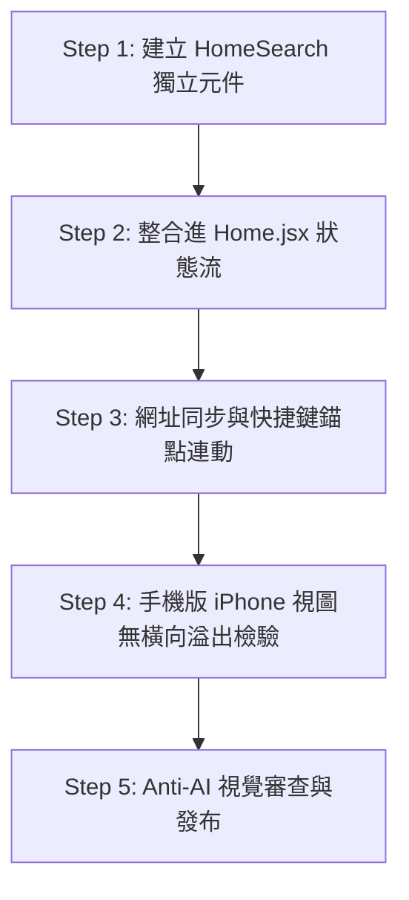

# 映後時光 — 搜尋架構首頁融合計畫（Anti-AI 設計與實作藍圖）

> **建立日期**：2026-10-16  
> **更新日期**：2026-10-19  
> **狀態**：規格定案與實作準備中  
> **核心目標**：將現有獨立的 `/search` 雙核心檢索（電影心得 + 主題策展片單 + 標籤），無縫融合移植至首頁（Home），徹底消除跳頁斷層；並嚴格貫徹「**反 AI 模板感（Anti-Generic AI Aesthetic）**」的電影人文美學，保持沉浸感與優雅的視覺秩序。

---

## 一、問題背景與首頁融合動機

### 1.1 現有架構的斷層
目前使用者在瀏覽「首頁（Home）」時，若想找尋特定電影、短評或主題片單，必須點擊導覽列「電影心得搜尋」，系統會硬性跳轉至 `/search` 獨立頁面。
- **體驗斷裂**：切斷了使用者在首頁觀看 Hero 輪播大片與瀏覽精選動態的沉浸流。
- **移動端成本高**：在 iPhone 等手機載具上，跳頁加載與往返返回的操作負擔沉重。

### 1.2 首頁融合的任務目標
1. **零跳頁沉浸體驗**：在首頁直接提供即時檢索能力，鍵入關鍵字後，首頁資訊流在原地平滑切換為「搜尋視圖」，清空時瞬間無縫還原。
2. **雙核心資料檢索不打折**：完整繼承心得全文搜尋（`reviews/search/?q=`）與策展片單搜尋（`lists/search/?q=`），以及標籤自動統計推薦。
3. **極致的人文電影美學**：堅拒時下 AI 生成介面的廉價罐頭感，讓搜尋元件如同高階藝術電影雜誌中的精緻索引，低調且充滿細節。

---

## 二、反「AI 模板感」五大核心設計準則（Anti-Generic AI Principles）

當代許多 AI 產生的網頁介面常陷入「過度設計」的盲點：充斥著炫目的強烈漸層、刺眼的霓虹外發光、隨處可見的厚重毛玻璃、五彩斑斕的糖果膠囊按鈕（Candy Pills），以及把每筆資料都套進一模一樣的懸浮大卡片中。這種「AI 罐頭感」嚴重破壞了電影特有的靜謐敘事與文學質感。

本融合計畫確立以下五大維度的對比準則，作為所有前端元件開發生產的唯一依據：

### 2.1 核心元件處理對比矩陣

| 元件 | 理想處理方式（人文 / 電影感） | 嚴格避免（反 AI 模板感） |
| :--- | :--- | :--- |
| **Hero 焦點區** | **保留電影畫面與原有敘事感**<br>海報、引言短句與電影氛圍完整呈現，讓視覺自然呼吸；搜尋框不破壞畫面完整度。 | **讓搜尋框蓋過海報或標題**<br>粗暴將搜尋框疊壓在電影畫面正中央，切斷觀者對電影的情緒連結與視覺焦點。 |
| **搜尋欄** | **低調、清楚，與首頁背景自然銜接**<br>沉穩微透的黑咖背景、極細邊框（Hairline），打字時僅給予細緻的輪廓呼應與柔和反饋。 | **過度發光、強烈漸層、厚重玻璃效果**<br>科技感炫光、霓虹陰影（Neon Glow）、高飽和彩色漸層外框、厚重毛玻璃（Heavy Backdrop Blur）。 |
| **推薦標籤** | **像編輯精選的關鍵字，使用文字或細邊框**<br>文字襯線氣質，搭配低對比細線框或字距留白，宛如電影手冊的策展關鍵字。 | **每個標籤都是彩色膠囊**<br>五顏六色的滿版高彩膠囊按鈕（Candy Pills / Rainbow Badges），宛如促銷廣告或罐頭儀表板。 |
| **分類 Tabs** | **明確的文字、底線或輕量選取狀態**<br>經典印刷品般的排版，選中項輔以典雅底線（Underline）或極輕微亮色指示。 | **所有分類都做成一排懸浮按鈕**<br>一整排浮動的圓角藥丸按鈕組，視覺雜亂、具壓迫感且喧賓奪主。 |
| **搜尋結果** | **以海報、片名、作者與內容建立層次**<br>海報呈現比例、文字粗細對比、短評引言區塊分明，各類型結果有各自的排版節奏。 | **每一筆結果都包在一張相同的浮動卡片裡**<br>同質化嚴重（Cookie-cutter Floating Cards），卡片套卡片造成視覺疲勞與資訊稀釋。 |

---

## 三、整體架構佈局：Hero 下方「動態視圖自然融合式」

在上述設計準則的檢驗下，原先設想的「方案 B（Hero 內嵌毛玻璃搜尋）」因直接違反「不得蓋過海報」與「避免厚重玻璃效果」已被正式否決。本專案正式採用 **Hero 下方自然銜接的動態視圖融合式架構**。

### 3.1 頁面佈局與動態切換流程

```
 ┌────────────────────────────────────────────────────────────┐
 │  [Hero 焦點輪播] (熱門電影海報 / 精選影評短句 / 串流預覽)     │
 │  維持完整留白與電影氛圍，不被任何輸入框侵入遮擋            │
 ├────────────────────────────────────────────────────────────┤
 │                                                            │
 │  ┌──────────────────────────────────────────────────────┐  │
 │  │ 🔍 搜尋電影、心得、主題片單...              [清空✕] │  │
 │  └──────────────────────────────────────────────────────┘  │
 │  編輯精選： #院線熱映  #週末放鬆  #燒腦神作  #諾蘭作品      │
 │  (極簡細邊框，點擊直接發動檢索)                            │
 │                                                            │
 ├────────────────────────────────────────────────────────────┤
 │                                                            │
 │  【狀態 1：未搜尋（預設首頁瀏覽模式）】                      │
 │   全部動態 ＿     電影專區      活動回顧                   │
 │   (經典文字底線 Tabs)                                       │
 │   -------------------------------------------------------  │
 │   渲染首頁精選資訊流（海報與動態自然穿插）                 │
 │                                                            │
 │  【狀態 2：鍵入關鍵字或點擊標籤（即時非同步搜尋模式）】       │
 │   全部結果 (12) ＿   電影心得 (8)    主題片單 (4)           │
 │   [← 返回全部動態]                                          │
 │   -------------------------------------------------------  │
 │   • 匹配電影：標準 2:3 海報網格 (PosterGrid)                │
 │   • 匹配片單：等比例 2:3 拼貼封面板塊 (ListCard)            │
 │   • 匹配心得：階層式引言短評，作者等級與星等一目瞭然        │
 │                                                            │
 └────────────────────────────────────────────────────────────┘
```

### 3.2 互動細節與動態體驗
1. **防抖非同步檢索 (Debounced Asynchronous Search)**：
   - 鍵入字元後 300ms 觸發雙核心檢索（心得 + 片單），首頁下方動態流平滑淡出，搜尋結果淡入。
2. **退出與重置機制**：
   - 搜尋框右側提供極簡的清空「✕」按鈕。
   - 搜尋結果左上方提供「← 返回全部動態」文字連結，點擊即可瞬間切換回原本的首頁動態流。
3. **雙向網址同步 (URL Sync)**：
   - 搜尋關鍵字即時同步至網址列（例如 `/?q=奧本海默`）。
   - 使用者複製連結分享給好友，或重新整理頁面時，能精準恢復至該搜尋結果狀態。
4. **全站快捷導覽跳轉**：
   - 點擊全站導覽列上的「電影心得搜尋」時，若已在首頁，頁面平滑滾動（Smooth Scroll）至搜尋欄並自動聚焦（Focus）；若在其他子頁面，則導向 `/?focus=search`。

---

## 四、前端元件實作與樣式規格 (CSS & Tokens Spec)

嚴格依據反 AI 模板感的準則，前端元件樣式規範如下：

### 4.1 搜尋欄 (`HomeSearch.module.css`)
```css
/* 低調、沉穩，與底色深色自然銜接，杜絕霓虹外發光與厚重毛玻璃 */
.searchContainer {
  max-width: 680px;
  margin: 36px auto 14px auto;
  position: relative;
  width: 100%;
  padding: 0 16px;
  box-sizing: border-box;
}

.searchInputWrapper {
  position: relative;
  display: flex;
  align-items: center;
  width: 100%;
}

.searchIcon {
  position: absolute;
  left: 16px;
  color: var(--text-muted);
  font-size: 1rem;
  pointer-events: none;
  transition: color 0.2s ease;
}

.searchInput {
  width: 100%;
  background: rgba(255, 255, 255, 0.03);
  border: 1px solid var(--border-color);
  border-radius: 8px; /* 沉穩微圓角，避免過度膨脹的大膠囊 */
  padding: 13px 44px 13px 44px;
  color: var(--text-primary);
  font-family: inherit;
  font-size: 0.95rem;
  letter-spacing: 0.02em;
  outline: none;
  box-sizing: border-box;
  transition: border-color 0.25s ease, background 0.25s ease;
}

.searchInput:focus {
  background: rgba(255, 255, 255, 0.05);
  border-color: var(--accent-primary);
  box-shadow: none; /* 拒絕炫彩霓虹光暈 (No Neon Glow) */
}

.clearBtn {
  position: absolute;
  right: 14px;
  background: none;
  border: none;
  color: var(--text-muted);
  font-size: 1.1rem;
  cursor: pointer;
  padding: 4px;
  transition: color 0.2s ease;
}

.clearBtn:hover {
  color: var(--text-primary);
}
```

### 4.2 編輯精選關鍵字 (`RecommendedKeywords`)
```css
/* 雜誌手冊排版風格，非彩色藥丸 */
.keywordList {
  display: flex;
  align-items: center;
  justify-content: center;
  flex-wrap: wrap;
  gap: 8px;
  margin-bottom: 32px;
  font-size: 0.85rem;
  padding: 0 16px;
}

.keywordLabel {
  color: var(--text-muted);
  font-size: 0.8rem;
  margin-right: 6px;
  letter-spacing: 0.08em;
  text-transform: uppercase;
}

.keywordItem {
  background: transparent;
  border: 1px solid rgba(255, 255, 255, 0.12);
  color: var(--text-secondary);
  padding: 4px 12px;
  border-radius: 4px; /* 極簡方角/微圓角 */
  font-size: 0.82rem;
  cursor: pointer;
  letter-spacing: 0.02em;
  transition: all 0.2s ease;
}

.keywordItem:hover {
  border-color: var(--accent-primary);
  color: var(--accent-primary);
  background: rgba(224, 160, 58, 0.06);
}
```

### 4.3 分類 Tabs (`TabsNavigation`)
```css
/* 明確的文字與底線指示，非浮動懸浮按鈕組 */
.tabsNav {
  display: flex;
  gap: 28px;
  border-bottom: 1px solid var(--border-color);
  margin-bottom: 24px;
  justify-content: flex-start;
}

.tabBtn {
  background: none;
  border: none;
  padding: 12px 2px;
  color: var(--text-muted);
  font-size: 0.95rem;
  font-weight: 500;
  cursor: pointer;
  position: relative;
  transition: color 0.2s ease;
}

.tabBtn:hover {
  color: var(--text-primary);
}

.tabBtn.active {
  color: var(--accent-primary);
  font-weight: 600;
}

.tabBtn.active::after {
  content: '';
  position: absolute;
  bottom: -1px;
  left: 0;
  right: 0;
  height: 2px;
  background: var(--accent-primary);
}
```

### 4.4 搜尋結果階層排版（異質多維度呈現）
- **電影維度**：直接採用標準 `PosterGrid` 2:3 海報，懸浮時展示平均評分與短評篇數，保留電影視覺開闊感。
- **主題片單維度**：採用與電影海報等比例的 2:3 `ListCard`，封面由 4 部電影海報構成拼貼，呈現電影收藏的份量感。
- **短評/心得維度**：採用「書摘/電影手冊」式排版，以評星、精選引言為核心，作者頭像與標籤輕量置於側邊或底部，讓文字本身產生節奏與重量，而非塞入千篇一律的白底/灰底陰影卡片中。

---

## 五、實作執行步驟與時程計畫



### 步驟 1：建立 `HomeSearch` 融合組件
- 建立 `frontend/src/components/HomeSearch.jsx` 與 `HomeSearch.module.css`。
- 內部處理：
  1. 輸入狀態（`query`）與 300ms 防抖計時器。
  2. 標籤點擊反查。
  3. 清除按鈕與焦點回饋。

### 步驟 2：整合進 `Home.jsx` 狀態流
- 在 `Home.jsx` 引入 `HomeSearch`，掛載於 Hero 輪播區與資訊流之間。
- 引入 `isSearching` 狀態判斷：
  - `query === ''`：渲染既有的首頁資訊流（全部動態 / 熱門推薦）。
  - `query !== ''`：非同步請求 `reviews/search/?q=` 與 `lists/search/?q=`，切換為「搜尋結果階層視圖」。

### 步驟 3：網址同步與快捷鍵錨點連動
- 使用 `useSearchParams` 讓關鍵字與網址雙向同步（支援重新整理與好友分享）。
- Navbar 上的「搜尋」按鈕若在首頁點擊，直接觸發平滑滾動並 `input.focus()`。

### 步驟 4：移動端（iPhone）適配與無溢出驗證
- 驗證 `<= 480px` 視圖，確保 `max-width: 100%`、`overflow-x: hidden`，搜尋欄寬度具備 16px 邊界安全邊距，海報維持 2 欄整齊排列。

---

## 六、Anti-AI 設計防呆驗收清單（Code Review Checklist）

在代碼合併與部署前，需逐一核對此清單：

- [ ] **Hero 區無遮擋**：Hero 輪播海報與電影標題、短評未被搜尋框覆蓋。
- [ ] **無彩虹光暈**：搜尋欄 `:focus` 時僅有香檳金細線，未出現擴散的彩色光暈或霓虹 box-shadow。
- [ ] **無糖果膠囊**：推薦關鍵字標籤背景透明，僅有 1px 細線框或純文字，絕非高飽和彩色滿版按鈕。
- [ ] **無浮動藥丸 Tabs**：分類切換為經典文字 + 底部 2px 細線指示器，無一整排浮動圓角卡片。
- [ ] **無同質化卡片套卡片**：搜尋結果中的電影、片單、心得各有其清晰的視覺語彙，心得採書摘引言階層排版。
- [ ] **手機版無橫向滾動**：iPhone 尺寸下左右無多餘白邊，Footer 與主畫面完全對齊置中。
